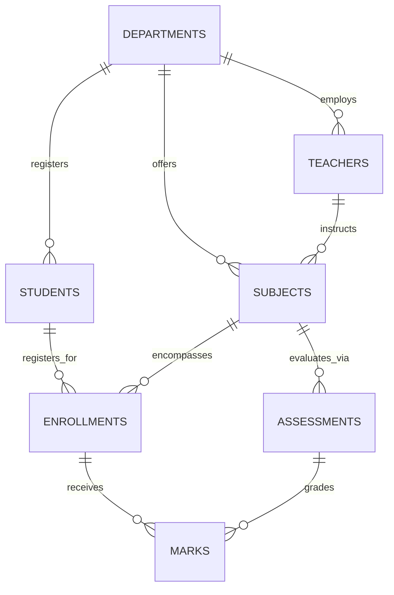

# DBMS MINI PROJECT REPORT

---

## **INTERNAL MARKS MANAGEMENT SYSTEM**

**Academic Year:** 2026–2027  
**Department:** Department of Computer Engineering  
**Institute:** K.K. Wagh Institute of Engineering Education and Research, Nashik  
**Affiliated To:** Savitribai Phule Pune University (SPPU), Pune  
**Course:** Database Management Systems (DBMS) Laboratory  

---

## 1. ABSTRACT

Continuous internal evaluation is a cornerstone of the engineering curriculum at Savitribai Phule Pune University (SPPU). Manual handling of marks across diverse evaluation heads—such as In-Semester examinations, End-Semester assessments, Unit Tests, Term Work, and Practical/Oral examinations—is prone to calculation inaccuracies, duplicate registrations, and delayed reporting. 

The **Internal Marks Management System** is a robust desktop database application engineered in Python with a Tkinter/ttk graphical interface and backed by a MySQL relational database. The system models seven interconnected entities: `departments`, `teachers`, `students`, `subjects`, `enrollments`, `assessments`, and `marks`. It enforces strict relational integrity, parameterized transactional queries, boundary validations (`0 <= marks_obtained <= max_marks`), and duplicate-entry prevention. Furthermore, the system automates the generation of three critical analytical reports: individual student marksheets, subject-wise pass/fail metrics, and overall class performance leaderboards with aggregate statistical measures.

---

## 2. PROBLEM STATEMENT & OBJECTIVES

### 2.1 Problem Statement
Educational institutions require an organized, error-free mechanism to record, compute, and analyze internal assessment scores. Existing spreadsheet-based workflows suffer from:
- Lack of referential integrity (orphan records and missing linkages).
- Duplicate enrollments and repeated grade entries.
- Unvalidated mark entry exceeding prescribed maximum thresholds.
- Absence of real-time aggregate reporting and class rankings.

### 2.2 Project Objectives
1. **Relational Database Design:** Architect a normalized relational schema (in 3NF/BCNF) comprising seven interrelated entities.
2. **Data Integrity & Constraints:** Implement primary keys, foreign keys with appropriate cascade/restrict behaviors, unique constraints, and check constraints.
3. **Automated Business Rules:** Develop database triggers and application-level validators to guarantee `0 <= marks_obtained <= max_marks` and eliminate duplicate entries.
4. **Desktop GUI Application:** Provide an intuitive, responsive Tkinter/`ttk` interface supporting complete CRUD operations, real-time filtering, and search functionality.
5. **Analytical Reporting:** Generate student-wise official marksheets, subject-wise performance analyses, and class merit distributions using SQL `JOIN`s, `GROUP BY`, and aggregate functions.
6. **Robust Error Handling:** Utilize parameterized queries and database transactions (`COMMIT`/`ROLLBACK`) to prevent SQL injection and corruption.

---

## 3. SYSTEM REQUIREMENTS & ENVIRONMENT

### 3.1 Software Requirements
- **Operating System:** Microsoft Windows 11 (64-bit)
- **Programming Language:** Python 3.10+ (Tested on Python 3.14)
- **GUI Framework:** Python Tkinter with `ttk` themed widgets
- **Database Server:** MySQL Server 8.0+
- **Database Driver:** `mysql-connector-python` 8.0+
- **Database Administration:** MySQL Command-Line Client (`mysql.exe`)

### 3.2 Hardware Requirements
- **Processor:** Intel Core i3 / AMD Ryzen 3 or higher
- **RAM:** 4 GB RAM minimum (8 GB recommended)
- **Disk Space:** 500 MB free hard drive space
- **Display Resolution:** 1280 x 720 minimum (1920 x 1080 recommended)

---

## 4. DATABASE DESIGN & MODELING

### 4.1 Entity-Relationship (ER) Diagram
The system defines seven key entities and their Cardinality Ratios:
- A **Department** employs many **Teachers** (1:N) and registers many **Students** (1:N).
- A **Department** offers multiple **Subjects** (1:N).
- A **Teacher** is assigned to instruct zero or more **Subjects** (1:N).
- A **Student** enrolls in multiple **Subjects** through an **Enrollment** entity (M:N decomposed into two 1:N relations).
- A **Subject** has multiple **Assessments** (1:N).
- An **Enrollment** receives **Marks** evaluated against specific **Assessments** (1:N).



---

### 4.2 Relational Schema Specifications

#### 1. `departments`
Stores academic divisions within the institute.
- `department_id` (INT, PK, AUTO_INCREMENT)
- `dept_code` (VARCHAR(10), UNIQUE, NOT NULL) — e.g., 'COMP'
- `dept_name` (VARCHAR(100), NOT NULL) — e.g., 'Computer Engineering'
- `intake_capacity` (INT, NOT NULL, CHECK > 0)
- `hod_name` (VARCHAR(100), NOT NULL)
- `established_year` (INT, CHECK >= 1984)

#### 2. `teachers`
Stores faculty members associated with departments.
- `teacher_id` (INT, PK, AUTO_INCREMENT)
- `emp_code` (VARCHAR(20), UNIQUE, NOT NULL) — e.g., 'T-COMP-101'
- `first_name` (VARCHAR(50), NOT NULL)
- `last_name` (VARCHAR(50), NOT NULL)
- `email` (VARCHAR(100), UNIQUE, NOT NULL)
- `phone` (VARCHAR(15), NULL)
- `designation` (VARCHAR(50), CHECK IN ('Professor', 'Associate Professor', 'Assistant Professor', 'Adjunct Faculty'))
- `department_id` (INT, FK -> `departments.department_id`, ON DELETE RESTRICT)

#### 3. `students`
Stores student academic profiles.
- `student_id` (INT, PK, AUTO_INCREMENT)
- `prn` (VARCHAR(20), UNIQUE, NOT NULL) — SPPU Permanent Registration Number
- `roll_no` (VARCHAR(15), NOT NULL) — e.g., 'TE-COMP-01'
- `first_name` (VARCHAR(50), NOT NULL)
- `last_name` (VARCHAR(50), NOT NULL)
- `email` (VARCHAR(100), UNIQUE, NOT NULL)
- `phone` (VARCHAR(15), NULL)
- `class_year` (VARCHAR(10), CHECK IN ('FE', 'SE', 'TE', 'BE'))
- `division` (VARCHAR(5), CHECK IN ('A', 'B', 'C', 'D'))
- `admission_year` (INT, NOT NULL)
- `department_id` (INT, FK -> `departments.department_id`, ON DELETE RESTRICT)
- **Constraint:** `UNIQUE (department_id, class_year, division, roll_no)`

#### 4. `subjects`
Stores course curriculum details.
- `subject_id` (INT, PK, AUTO_INCREMENT)
- `subject_code` (VARCHAR(20), UNIQUE, NOT NULL) — e.g., '310241'
- `subject_name` (VARCHAR(100), NOT NULL) — e.g., 'Database Management Systems'
- `semester` (INT, CHECK 1 <= semester <= 8)
- `class_year` (VARCHAR(10), CHECK IN ('FE', 'SE', 'TE', 'BE'))
- `credits` (INT, CHECK credits > 0)
- `department_id` (INT, FK -> `departments.department_id`, ON DELETE RESTRICT)
- `teacher_id` (INT, NULL, FK -> `teachers.teacher_id`, ON DELETE SET NULL)

#### 5. `enrollments`
Represents student registration for specific courses and academic terms.
- `enrollment_id` (INT, PK, AUTO_INCREMENT)
- `student_id` (INT, FK -> `students.student_id`, ON DELETE CASCADE)
- `subject_id` (INT, FK -> `subjects.subject_id`, ON DELETE RESTRICT)
- `academic_year` (VARCHAR(15), NOT NULL) — e.g., '2026-2027'
- `semester` (INT, CHECK 1 <= semester <= 8)
- `enrollment_date` (DATE, NOT NULL)
- `status` (VARCHAR(20), CHECK IN ('Active', 'Completed', 'Dropped'))
- **Constraint:** `UNIQUE (student_id, subject_id, academic_year, semester)` *(Prevents duplicate enrollment)*

#### 6. `assessments`
Defines evaluation heads for a course.
- `assessment_id` (INT, PK, AUTO_INCREMENT)
- `subject_id` (INT, FK -> `subjects.subject_id`, ON DELETE CASCADE)
- `assessment_name` (VARCHAR(100), NOT NULL) — e.g., 'In-Semester Exam'
- `assessment_type` (VARCHAR(30), CHECK IN ('In-Semester', 'End-Semester', 'Unit Test', 'Term Work', 'Practical / Oral', 'Assignment'))
- `max_marks` (DECIMAL(5,2), CHECK > 0) — e.g., 30.00
- `weightage_percent` (DECIMAL(5,2), CHECK > 0 AND <= 100)
- `conducted_date` (DATE, NULL)
- `academic_year` (VARCHAR(15), NOT NULL)
- **Constraint:** `UNIQUE (subject_id, assessment_name, academic_year)`

#### 7. `marks`
Stores student assessment marks.
- `mark_id` (INT, PK, AUTO_INCREMENT)
- `enrollment_id` (INT, FK -> `enrollments.enrollment_id`, ON DELETE CASCADE)
- `assessment_id` (INT, FK -> `assessments.assessment_id`, ON DELETE CASCADE)
- `marks_obtained` (DECIMAL(5,2), NOT NULL, CHECK >= 0.00)
- `is_absent` (BOOLEAN, NOT NULL DEFAULT FALSE)
- `remarks` (VARCHAR(255), NULL)
- `entered_at` (TIMESTAMP)
- `updated_at` (TIMESTAMP)
- **Constraint:** `UNIQUE (enrollment_id, assessment_id)` *(Prevents duplicate marks)*

---

### 4.3 Normalization Analysis
The relational design complies with **Boyce-Codd Normal Form (BCNF)**:
1. **First Normal Form (1NF):** All attributes are atomic; no multivalued attributes or repeating groups exist.
2. **Second Normal Form (2NF):** Every table possesses an artificial surrogate primary key (`*_id`). All non-prime attributes are fully functionally dependent on the entire primary key, eliminating partial dependencies.
3. **Third Normal Form (3NF):** No transitive dependencies exist. For example, in `students`, department attributes (`dept_name`, `hod_name`) are factored out into `departments` and referenced via foreign key `department_id`.
4. **Boyce-Codd Normal Form (BCNF):** For every functional dependency $X \rightarrow Y$, $X$ is a superkey. Candidate keys (`prn`, `emp_code`, `subject_code`, `dept_code`, compound unique constraints) have separate unique constraints ensuring non-trivial dependencies are sound.

---

### 4.4 Integrity Rules & Triggers
To enforce that a student's score cannot exceed the maximum mark set for that evaluation head, a MySQL trigger is configured:

```sql
DELIMITER //
CREATE TRIGGER trg_validate_marks_insert
BEFORE INSERT ON marks
FOR EACH ROW
BEGIN
    DECLARE v_max_marks DECIMAL(5,2);
    SELECT max_marks INTO v_max_marks
    FROM assessments
    WHERE assessment_id = NEW.assessment_id;

    IF NEW.is_absent = TRUE THEN
        SET NEW.marks_obtained = 0.00;
    ELSEIF NEW.marks_obtained > v_max_marks THEN
        SIGNAL SQLSTATE '45000'
        SET MESSAGE_TEXT = 'Validation Error: Marks obtained cannot exceed assessment maximum marks';
    END IF;
END //
DELIMITER ;
```

---

## 5. GUI MODULES & ARCHITECTURE

The application adopts a modular, tiered architecture separating database access from graphical presentation:

```
+-------------------------------------------------------+
|                    Tkinter Desktop GUI                |
|  (Dashboard, Departments, Teachers, Students, Courses,|
|   Enrollments, Assessments, Marks Entry, Reports)     |
+-------------------------------------------------------+
                           |
+-------------------------------------------------------+
|                Database Access Layer (db.py)          |
|  - Parameterized Queries (%s)                         |
|  - Transaction Management (Commit / Rollback)         |
|  - Safe Connection Pool & Multi-Engine Driver         |
+-------------------------------------------------------+
                           |
+-------------------------------------------------------+
|                  MySQL Server 8.0                     |
|  (InnoDB Engine, Foreign Keys, Triggers, Views)       |
+-------------------------------------------------------+
```

### Module Descriptions
1. **Institutional Dashboard:** Provides visual KPI cards (Total Students, Teachers, Courses, Marks recorded) and a live tabular feed of the most recent assessment entries.
2. **Department Management:** Full CRUD operations for departments, including intake capacity and HOD appointment.
3. **Teacher Management:** Manages faculty records, designations, and departmental associations with designation filters.
4. **Student Management:** Maintains PRN identity, class year (`FE`, `SE`, `TE`, `BE`), division, roll numbers, and contact details.
5. **Subject Management:** Configures SPPU course codes, course titles, assigned faculty in-charge, and credits.
6. **Enrollment Management:** Registers students into courses per semester. Includes a **Batch Enroll Class** utility to enroll an entire class year into a course in a single operation.
7. **Assessment Management:** Sets up evaluation heads (In-Sem 30 marks, End-Sem 70 marks, Term Work 25 marks, Practical 25 marks).
8. **Marks Entry & Updating:** High-efficiency grading screen. Selecting a Subject and Assessment automatically loads all enrolled students. Allows recording marks, toggling absence, and validating boundaries.
9. **Academic Reports & Marksheet:**
   - **Student Marksheet:** Calculates total scored, total maximum, overall percentage, and SPPU grade classification (Distinction, First Class, Pass, Fail). Allows exporting to a clean text marksheet.
   - **Subject Performance Report:** Aggregates pass percentage, mean score, highest score, and lowest score.
   - **Class Performance Analytics:** Displays ranked class merit leaderboards and division-wide performance analytics.
10. **Database Settings & Setup:** Built-in connection tester and automated SQL script runner.

---

## 6. ADVANCED SQL QUERIES DEMONSTRATED

### 6.1 Multi-Table JOIN for Student Marksheet
Demonstrates joining five tables (`marks`, `enrollments`, `students`, `assessments`, `subjects`) to compute assessment percentages:
```sql
SELECT 
    s.prn, s.roll_no,
    CONCAT(s.first_name, ' ', s.last_name) AS student_name,
    sub.subject_code, sub.subject_name,
    a.assessment_name, a.max_marks,
    m.marks_obtained, m.is_absent,
    ROUND((m.marks_obtained / a.max_marks) * 100, 2) AS percentage,
    CASE 
        WHEN m.is_absent = 1 THEN 'Absent'
        WHEN (m.marks_obtained / a.max_marks) >= 0.40 THEN 'Pass'
        ELSE 'Fail'
    END AS result_status
FROM marks m
JOIN enrollments e ON m.enrollment_id = e.enrollment_id
JOIN students s ON e.student_id = s.student_id
JOIN assessments a ON m.assessment_id = a.assessment_id
JOIN subjects sub ON a.subject_id = sub.subject_id
WHERE s.student_id = %s
ORDER BY sub.subject_code, a.assessment_name;
```

### 6.2 Aggregation and GROUP BY for Subject Performance
Demonstrates `COUNT`, `SUM(CASE ...)`, `AVG`, `MAX`, and `MIN` grouped by subject and assessment:
```sql
SELECT 
    sub.subject_code, sub.subject_name, a.assessment_name, a.max_marks,
    COUNT(m.mark_id) AS total_appeared,
    SUM(CASE WHEN m.is_absent = 0 AND (m.marks_obtained / a.max_marks) >= 0.40 THEN 1 ELSE 0 END) AS passed_count,
    ROUND(AVG(CASE WHEN m.is_absent = 0 THEN m.marks_obtained ELSE NULL END), 2) AS avg_marks,
    MAX(CASE WHEN m.is_absent = 0 THEN m.marks_obtained ELSE NULL END) AS highest_marks,
    MIN(CASE WHEN m.is_absent = 0 THEN m.marks_obtained ELSE NULL END) AS lowest_marks
FROM subjects sub
JOIN assessments a ON sub.subject_id = a.subject_id
LEFT JOIN marks m ON a.assessment_id = m.assessment_id
WHERE sub.subject_id = %s
GROUP BY sub.subject_code, sub.subject_name, a.assessment_name, a.max_marks;
```

### 6.3 Class Merit Leaderboard with Aggregate Functions
Demonstrates summing marks across different assessments per student to calculate cumulative rank:
```sql
SELECT 
    s.student_id, s.roll_no, s.prn,
    CONCAT(s.first_name, ' ', s.last_name) AS student_name,
    SUM(m.marks_obtained) AS total_scored,
    SUM(a.max_marks) AS total_max,
    ROUND((SUM(m.marks_obtained) / SUM(a.max_marks)) * 100, 2) AS overall_percentage
FROM students s
JOIN enrollments e ON s.student_id = e.student_id
JOIN marks m ON e.enrollment_id = m.enrollment_id
JOIN assessments a ON m.assessment_id = a.assessment_id
WHERE s.class_year = 'TE' AND s.division = 'A'
GROUP BY s.student_id, s.roll_no, s.prn, s.first_name, s.last_name
ORDER BY overall_percentage DESC;
```

---

## 7. VERIFICATION & TEST RESULTS

An automated suite consisting of 12 unit and integration test cases was executed against the database layer and GUI controllers:

```
----------------------------------------------------------------------
Ran 12 tests in 1.232s

OK
  [OK] Table 'departments' verified with 3 records.
  [OK] Table 'teachers' verified with 5 records.
  [OK] Table 'students' verified with 10 records.
  [OK] Table 'subjects' verified with 6 records.
  [OK] Table 'enrollments' verified with 21 records.
  [OK] Table 'assessments' verified with 12 records.
  [OK] Table 'marks' verified with 44 records.
  [OK] Constraint uq_student_enrollment successfully blocked duplicate enrollment.
  [OK] Constraint uq_enrollment_assessment successfully blocked duplicate marks entry.
  [OK] Trigger/Check successfully prevented marks > max_marks (35 > 30).
  [OK] Student Marksheet Query: Total 423.0/475.0 (89.05%)
  [OK] Subject Performance Summary Query returned 5 assessment aggregates.
  [OK] Class TE Div A: 8 students, Class Avg: 77.5%
```

---

## 8. CONCLUSION & FUTURE SCOPE

### 8.1 Conclusion
The **Internal Marks Management System** successfully accomplishes all requirements of a collegiate DBMS mini project. It provides a reliable, secure desktop environment for managing academic assessments without reliance on external web servers or commercial GUI frontends. By enforcing constraints at both the database and application levels, it prevents data anomalies, ensures referential integrity, and automates report generation.

### 8.2 Future Scope
1. **Automated Barcode/QR Code Generation:** Embed QR codes into exported student marksheets for instant verification.
2. **Email Notification Module:** Automatically dispatch marksheet PDF copies to students and parents upon completion of grading.
3. **Role-Based Access Control (RBAC):** Introduce teacher login and student portal credentials to restrict viewing and updating rights.

---

## 9. REFERENCES
1. Silberschatz, A., Korth, H. F., & Sudarshan, S. (2020). *Database System Concepts* (7th ed.). McGraw-Hill.
2. Elmasri, R., & Navathe, S. B. (2016). *Fundamentals of Database Systems* (7th ed.). Pearson.
3. MySQL 8.0 Reference Manual — Oracle Corporation.
4. Python 3 Documentation — Python Software Foundation.
5. Savitribai Phule Pune University (SPPU) — Curriculum & Assessment Scheme for Computer Engineering (2019/2024 Pattern).
