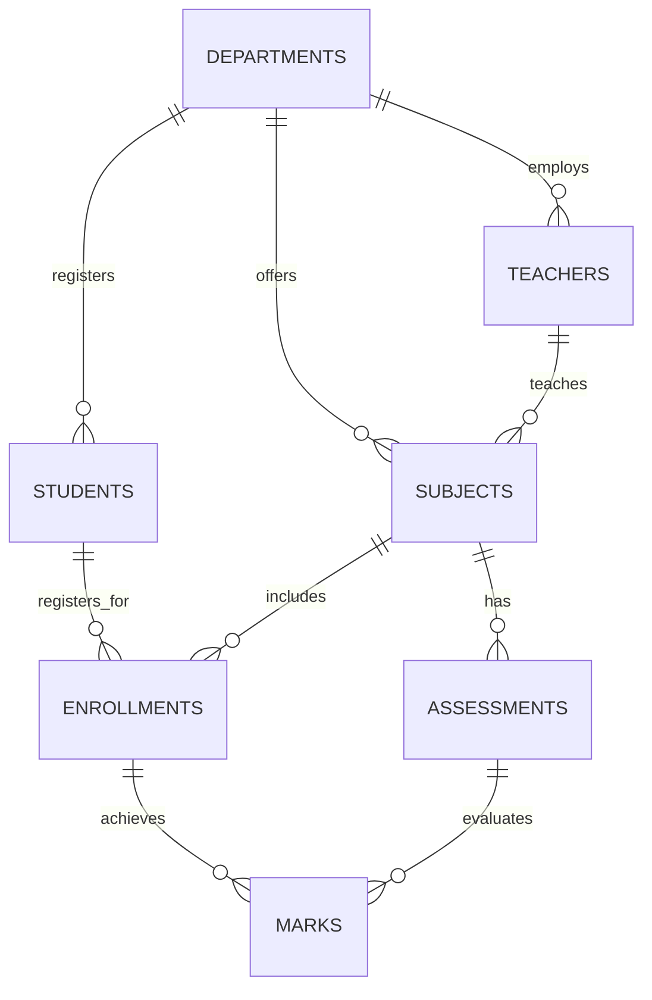

# Internal Marks Management System (DBMS Mini Project)

**Institution:** K.K. Wagh Institute of Engineering Education and Research, Nashik  
**Department:** Department of Computer Engineering  
**Academic Year:** 2026–2027  
**Course:** Database Management Systems (DBMS) Mini Project  
**Technology Stack:** Python 3.10+, Tkinter with ttk, MySQL Server 8.0+, `mysql-connector-python`  
**Platform:** Windows 11  

---

## 📌 Project Overview

The **Internal Marks Management System** is a professional desktop database application designed to manage curriculum courses, student enrollments, faculty allocations, continuous assessments (In-Sem, End-Sem, Unit Tests, Term Work, Practical/Oral), and grade evaluations according to the Savitribai Phule Pune University (SPPU) Computer Engineering curriculum.

### Key Highlights
- **100% Desktop GUI:** Built with Python Tkinter and modern `ttk` styling (No web frameworks required).
- **7 Normalized Tables:** Fully structured relational schema with Primary Keys, Foreign Keys (`ON DELETE RESTRICT` / `CASCADE`), Unique Keys, and Check Constraints.
- **Strict Integrity Enforcement:**
  - Prevents duplicate enrollments for the same student, course, and academic year.
  - Prevents duplicate marks entry for the same enrollment and assessment.
  - Validates that marks obtained are strictly between `0.00` and the assessment maximum marks.
- **Advanced SQL Demonstrations:**
  - Multi-table `INNER JOIN` and `LEFT JOIN` operations.
  - Grouping and Aggregates (`SUM`, `AVG`, `COUNT`, `MAX`, `MIN`, `GROUP BY`, `HAVING`).
  - Database Views and Triggers.
- **Comprehensive Reports:**
  - Student-wise Official Marksheet (with Distinction/First Class classification and text export).
  - Subject-wise Performance & Pass Rate Analytics.
  - Class Merit Leaderboard & Overall Division Statistics.

---

## 🗂️ System Architecture & Database Design

### 1. Entity-Relationship (ER) Model
The database consists of seven related tables:
1. **`departments`**: Academic departments (`department_id` PK, `dept_code` UNIQUE, `dept_name`, `intake_capacity`, `hod_name`, `established_year`).
2. **`teachers`**: Faculty members (`teacher_id` PK, `emp_code` UNIQUE, `first_name`, `last_name`, `designation`, `department_id` FK).
3. **`students`**: Student records (`student_id` PK, `prn` UNIQUE, `roll_no`, `class_year`, `division`, `department_id` FK).
4. **`subjects`**: Course curriculum (`subject_id` PK, `subject_code` UNIQUE, `subject_name`, `semester`, `credits`, `department_id` FK, `teacher_id` FK).
5. **`enrollments`**: Student course registrations (`enrollment_id` PK, `student_id` FK, `subject_id` FK, `academic_year`, `semester`, `UNIQUE(student_id, subject_id, academic_year, semester)`).
6. **`assessments`**: Evaluation heads (`assessment_id` PK, `subject_id` FK, `assessment_name`, `assessment_type`, `max_marks`, `UNIQUE(subject_id, assessment_name, academic_year)`).
7. **`marks`**: Recorded evaluation scores (`mark_id` PK, `enrollment_id` FK, `assessment_id` FK, `marks_obtained`, `is_absent`, `UNIQUE(enrollment_id, assessment_id)`).



---

## 💻 Windows 11 Step-by-Step Setup Guide

### Step 1: Prerequisites
1. **Python 3.10+**: Download from [python.org](https://www.python.org/) (ensure **"Add python.exe to PATH"** is checked).
2. **MySQL Server 8.0+**: Download and install MySQL Community Server from [mysql.com](https://dev.mysql.com/downloads/mysql/).  
   *(Note: MySQL Workbench is NOT required; only the MySQL Server and CLI are used).*

---

### Step 2: Database Setup via MySQL Command-Line Client

1. Open **Windows PowerShell** or the **MySQL Command Line Client** from the Start Menu.
2. Log into MySQL:
   ```powershell
   mysql -u root -p
   ```
   *(Enter your MySQL root password when prompted)*

3. Run the schema creation script:
   ```sql
   source database.sql;
   ```
4. Load the realistic sample records:
   ```sql
   source sample_data.sql;
   ```
5. Verify tables are present:
   ```sql
   USE internal_marks_db;
   SHOW TABLES;
   ```

---

### Step 3: Install Python Dependencies

Open PowerShell in the project directory (`cd C:\Users\Asus 16x\Desktop\project\dbms_mini`):

```powershell
pip install -r requirements.txt
```

---

### Step 4: Configure Database Connection

Open `db_config.json` (or use the built-in GUI **DB Config** tab):
```json
{
    "db_engine": "mysql",
    "mysql": {
        "host": "localhost",
        "port": 3306,
        "user": "root",
        "password": "YOUR_MYSQL_PASSWORD",
        "database": "internal_marks_db"
    }
}
```

> **Offline / Standalone Demo Mode:**  
> If MySQL is not running on a computer during presentation, simply toggle `"db_engine": "sqlite"` in `db_config.json` or click **Database Settings** inside the application. The system will operate seamlessly with the identical schema and sample records!

---

### Step 5: Launch the Application

Run the desktop application:
```powershell
python main.py
```

---

## 🧪 Running Automated Tests

Run the full test suite (verifying table constraints, duplicate prevention, trigger validations, and GUI views):

```powershell
# Run all tests
python -m unittest discover -s tests -p "test_*.py"

# Or run specific tests
python -m unittest tests/test_schema_and_db.py
python -m unittest tests/test_gui_integration.py
```

---

## 📂 Project Directory Structure

```
dbms_mini/
├── database.sql                  # MySQL DDL (7 Tables, Constraints, Views, Triggers)
├── sample_data.sql               # KKWIEER Computer Dept Sample Records
├── requirements.txt              # Project dependencies
├── README.md                     # Setup & Execution Documentation
├── PROJECT_REPORT.md             # Formal College Mini Project Documentation
├── PRESENTATION_OUTLINE.md       # Viva Slides & Exam Q&A Guide
├── TESTING_CHECKLIST.md          # Comprehensive Testing & Verification Matrix
├── config.py                     # Configuration manager
├── db.py                         # DAL: Transactions, Connection pooling, Query APIs
├── main.py                       # Desktop App Entry Point & Navigation
├── ui/
│   ├── __init__.py
│   ├── theme.py                  # Modern styles, color tokens, ttk theme
│   ├── components.py             # Reusable UI widgets (DataTable, StatCard, SearchBar, FormModal)
│   └── views/
│       ├── __init__.py
│       ├── dashboard_view.py     # Institutional overview and live KPIs
│       ├── department_view.py    # Department CRUD & search
│       ├── teacher_view.py       # Faculty profiles & appointments
│       ├── student_view.py       # Student enrollment profiles & filtering
│       ├── subject_view.py       # Course curriculum & teacher mapping
│       ├── enrollment_view.py    # Course registration & batch enrollment
│       ├── assessment_view.py    # Evaluation heads (In-Sem, End-Sem, etc.)
│       ├── marks_entry_view.py   # Marks entry, boundary validation & absence
│       ├── reports_view.py       # Marksheets, Subject reports, Class analytics
│       └── settings_view.py      # Connection manager & DB initialization wizard
└── tests/
    ├── __init__.py
    ├── test_schema_and_db.py     # Constraints & SQL Query unit tests
    └── test_gui_integration.py   # GUI components integration tests
```

---

## 👨‍💻 Project Information

- **Institute:** K.K. Wagh Institute of Engineering Education and Research, Nashik
- **Department:** Department of Computer Engineering
- **Academic Year:** 2026–2027
- **Course:** Database Management Systems Laboratory (Mini Project)
